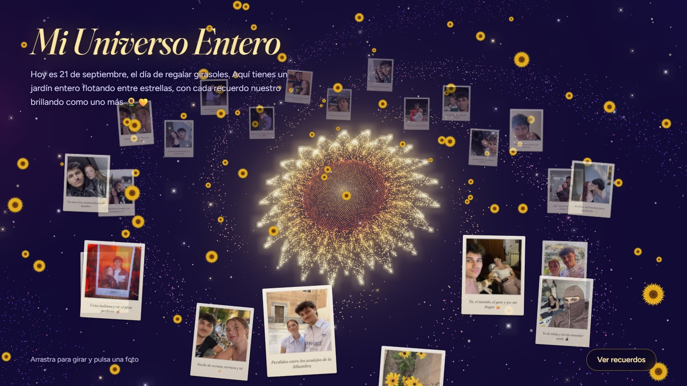
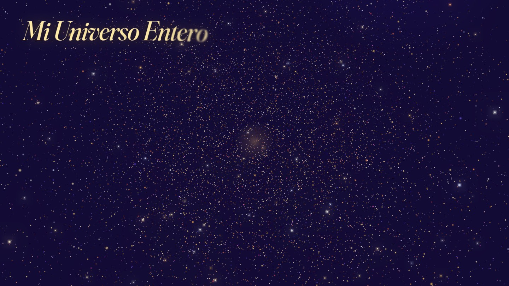
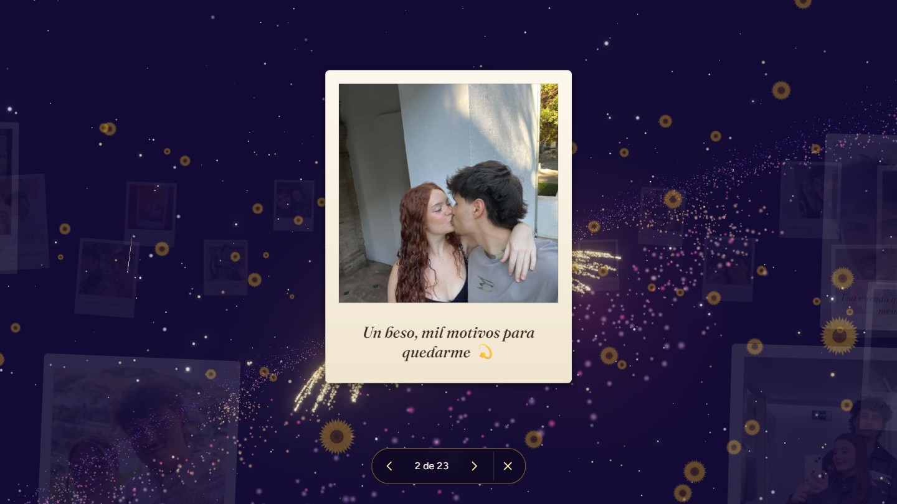
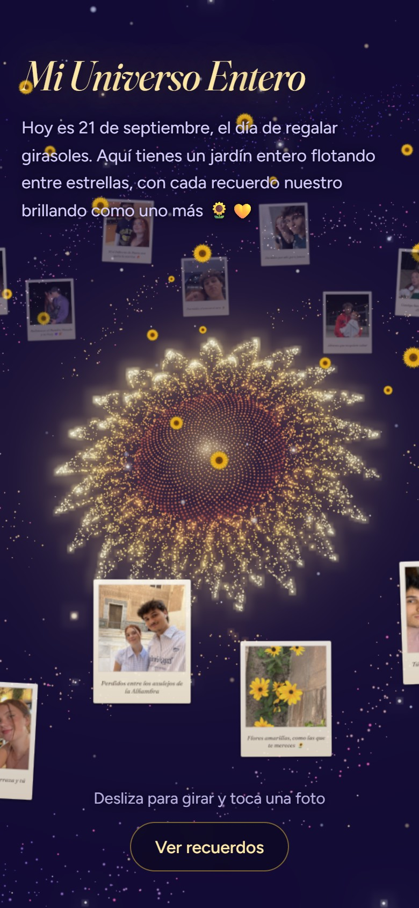
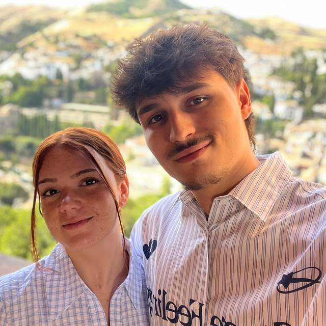

<div align="center">


# Mi Universo Entero

**Una galaxia con forma de girasol para el 21 de septiembre, con nuestros recuerdos flotando entre estrellas.**

Escena 3D interactiva con Three.js, sin paso de compilación.

[](https://alejandronicolasdelalamo.github.io/21-de-septiembre/)




**[Ver la demo](https://alejandronicolasdelalamo.github.io/21-de-septiembre/)**

</div>

---

## Qué es

El 21 de septiembre es el día de regalar flores amarillas. Esta página regala un jardín entero: más de 20 000 estrellas que empiezan dispersas por el espacio y se van juntando hasta formar un girasol del tamaño de una galaxia. A su alrededor flotan girasoles pequeños y 23 polaroids con fotos y su dedicatoria.

- **Arrastra** (o desliza) para orbitar alrededor de la flor, y usa la **rueda** o el **pellizco** para acercarte.
- **Pulsa una foto** y la cámara vuela hasta ella; el resto del universo se atenúa.
- Con una foto abierta, pasa a la siguiente con las **flechas**, los botones o **deslizando**: la siguiente es siempre la que queda a su derecha. **Esc** vuelve a la vista general.

<table>
  <tr>
    <td></td>
    <td></td>
  </tr>
</table>

<p align="center">
  
</p>

## El girasol, por dentro

La flor no es una textura: cada punto es una estrella colocada con matemáticas de girasol de verdad.

- **Disco de pipas.** Sigue el modelo de filotaxis de Vogel: la pipa *n* está a un radio proporcional a √*n* y girada *n* veces el **ángulo áureo** (≈ 137,5°). Es el patrón que dibuja las espirales de un girasol real.
- **21 pétalos** en dos capas. Veintiuno por el 21 de septiembre, y porque es un número de Fibonacci, como el número de pétalos de muchos girasoles.
- **Cinco brazos espirales** de polvo estelar que se disuelven de oro a violeta.

## Cómo está hecho

- **Sombreadores GLSL propios.** Cada estrella guarda su posición final y una inicial dispersa; el sombreador de vértices interpola entre ambas con un retraso propio por estrella, así toda la animación de entrada ocurre en la GPU. El mismo sombreador hace el centelleo y la rotación.
- **Dos pasadas de dibujo.** Lo luminoso pasa por un compositor con *bloom* (`UnrealBloomPass`); las fotos y los girasoles se pintan después, directamente en pantalla, para que el resplandor no queme las caras ni altere sus colores.
- **Cámara orbital propia** ([`js/orbita.js`](js/orbita.js)), sin `OrbitControls`. Los gestos solo cambian valores objetivo y la cámara se acerca a ellos con amortiguación independiente de los fps: orbitar, hacer zoom y volar a una foto son el mismo movimiento continuo, sin saltos. Admite ratón, táctil con pellizco, rueda y teclado, y distingue un toque de un arrastre.
- **Texturas generadas en `<canvas>`.** Los girasoles, los halos y los marcos de polaroid (con su pie escrito y partido en líneas) se dibujan al cargar: las únicas imágenes que se descargan son las fotos.
- **Calidad adaptativa.** Si el equipo no llega a unos 40 fps, baja la resolución interna y, como último recurso, desactiva el *bloom*. En táctiles se usan menos partículas y texturas más ligeras.
- **Three.js incluido en el repositorio** (`vendor/`), cargado con un *import map*. No depende de ninguna CDN para funcionar.

## Mejora progresiva y accesibilidad

Las fotos son HTML normal (`<figure>` con su `alt` y su `<figcaption>`), y la escena 3D las lee de ahí. Eso permite que la página funcione siempre:

| Situación | Qué se ve |
| --- | --- |
| Navegador con WebGL | La galaxia interactiva |
| Sin WebGL, o si se pierde el contexto gráfico | Una galería de polaroids con las mismas fotos |
| Sin JavaScript | La misma galería |
| «Reducir movimiento» activado | La galaxia ya formada, sin giro automático ni transiciones de cámara |

Además, todo se puede recorrer con teclado, los botones tienen nombre accesible y cada foto que se abre se anuncia a los lectores de pantalla con su descripción y su dedicatoria.

## Personalizar

Todo el contenido está en [`index.html`](index.html), marcado con ✏️:

- **Título y dedicatoria:** el `<h1>` y el párrafo de la cabecera.
- **Fotos:** cada `<figure class="recuerdo">` es una polaroid. Para añadir, quitar o cambiar una basta con editar esa lista; la escena reparte en órbita las que haya, en ese orden (la siguiente queda a la derecha), y agranda el anillo si hacen falta más huecos.

```html
<figure class="recuerdo">
  
  <figcaption>Granada, contigo el paisaje siempre es mejor 🌻</figcaption>
</figure>
```

Las fotos se recortan a cuadrado desde el centro; entre 640 y 960 px de lado es suficiente.

## Ejecutarlo en local

Usa módulos ES, así que hay que servirlo por HTTP (abrir el archivo con doble clic no funciona):

```bash
python -m http.server 8000
```

Después abre `http://localhost:8000`.

## Estructura

```
├── index.html          Título, dedicatoria y lista de recuerdos
├── css/estilos.css     Interfaz, galería alternativa y transiciones
├── js/
│   ├── main.js         Arranque, visor de fotos y teclado
│   ├── universo.js     Escena, bucle de dibujo y calidad adaptativa
│   ├── galaxia.js      Geometría del girasol y sombreadores GLSL
│   ├── orbita.js       Cámara orbital con amortiguación y gestos
│   ├── texturas.js     Girasoles, halos y polaroids dibujados en canvas
│   └── util.js         Suavizados y generador aleatorio con semilla
├── assets/fotos/       Las fotos
├── vendor/three/       Three.js r160 y los módulos de posprocesado
└── docs/               Capturas de este README
```

## Licencia

El código se publica bajo licencia [MIT](LICENSE). **Las fotografías son personales y no están incluidas en esa licencia.** [Three.js](https://threejs.org/) conserva su propia licencia MIT en `vendor/three/`. Tipografías [Fraunces](https://fonts.google.com/specimen/Fraunces) y [Figtree](https://fonts.google.com/specimen/Figtree), servidas por Google Fonts.
