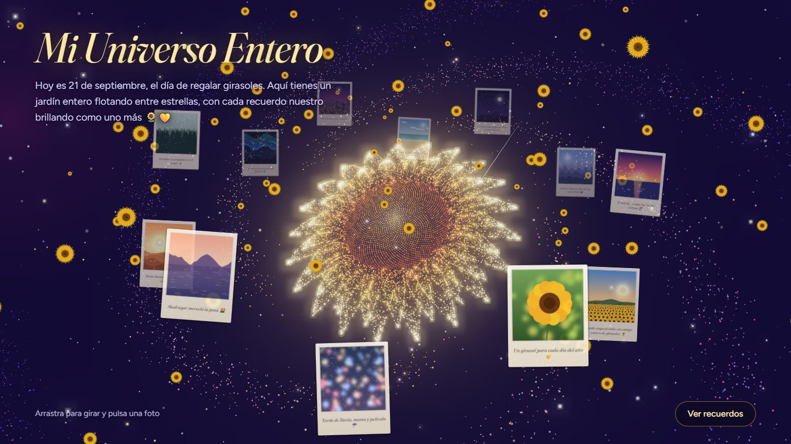
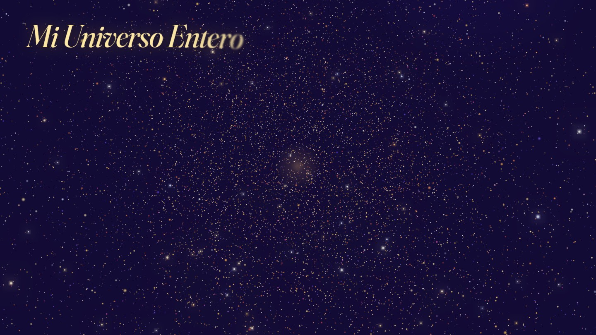
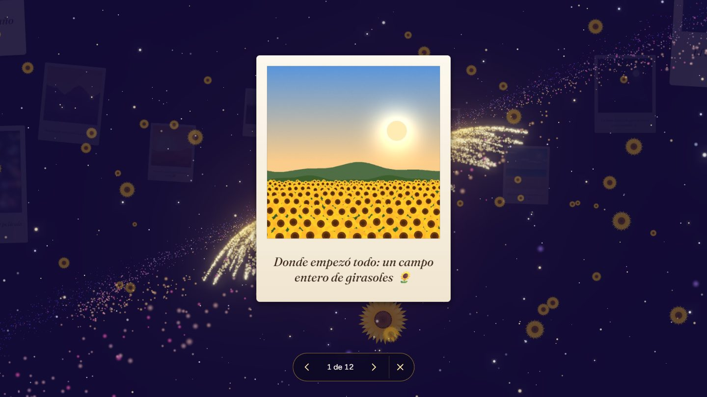
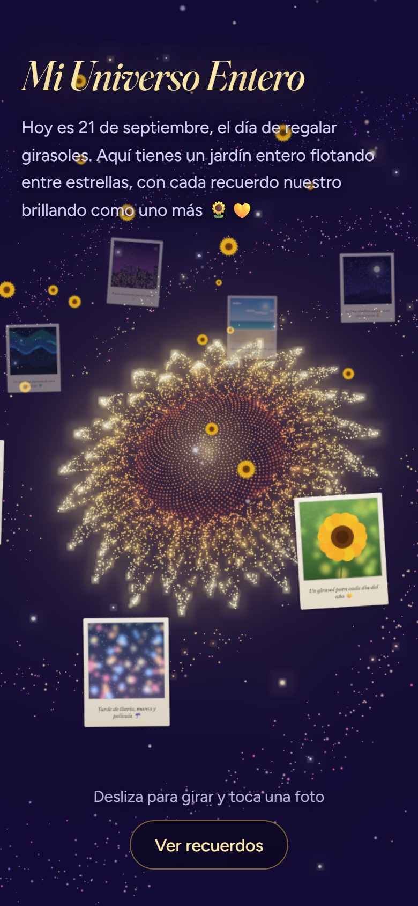

<div align="center">


# Mi Universo Entero · demo

**Una galaxia con forma de girasol hecha de más de 20 000 estrellas, con recuerdos en polaroid flotando a su alrededor.**

Escena 3D interactiva con Three.js y sombreadores GLSL propios, sin paso de compilación.

[](https://alejandronicolasdelalamo.github.io/21-de-septiembre/demo/)




**[Ver la demo](https://alejandronicolasdelalamo.github.io/21-de-septiembre/demo/)**

</div>

---

## Qué es esta carpeta

Es la versión pública de la página: la misma escena, el mismo CSS y el mismo JavaScript que la original, pero con **12 paisajes ilustrados** en lugar de fotos personales. Los paisajes están generados por código, así que no tienen derechos de terceros.

Solo cambian dos cosas respecto a la página principal:

- [`index.html`](index.html): la lista de recuerdos y las rutas a los recursos compartidos (`../css`, `../js`, `../vendor`).
- [`fotos/`](fotos/): las imágenes de ejemplo.

## Cómo se usa

- **Arrastra** (o desliza) para orbitar alrededor de la flor, y usa la **rueda** o el **pellizco** para acercarte.
- **Pulsa una foto** y la cámara vuela hasta ella; el resto del universo se atenúa.
- Con una foto abierta, pasa a la siguiente con las **flechas**, los botones o **deslizando**. **Esc** vuelve a la vista general.

<table>
  <tr>
    <td></td>
    <td></td>
  </tr>
</table>

<p align="center">
  
</p>

## El girasol, por dentro

La flor no es una textura: cada punto es una estrella colocada con matemáticas de girasol de verdad.

- **Disco de pipas.** Sigue el modelo de filotaxis de Vogel: la pipa *n* está a un radio proporcional a √*n* y girada *n* veces el **ángulo áureo** (≈ 137,5°).
- **21 pétalos** en dos capas, un número de Fibonacci, como el de muchos girasoles reales.
- **Cinco brazos espirales** de polvo estelar que se disuelven de oro a violeta.

## Cómo está hecho

- **Sombreadores GLSL propios.** Cada estrella guarda su posición final y una inicial dispersa; el sombreador de vértices interpola entre ambas con un retraso propio, así toda la animación de entrada ocurre en la GPU.
- **Dos pasadas de dibujo.** Lo luminoso pasa por un compositor con *bloom* (`UnrealBloomPass`); las fotos y los girasoles se pintan después, para que el resplandor no altere sus colores.
- **Cámara orbital propia** ([`js/orbita.js`](../js/orbita.js)), sin `OrbitControls`, con amortiguación independiente de los fps. Admite ratón, táctil con pellizco, rueda y teclado.
- **Texturas generadas en `<canvas>`.** Girasoles, halos y marcos de polaroid se dibujan al cargar.
- **Calidad adaptativa.** Si el equipo no llega a unos 40 fps, baja la resolución interna y, como último recurso, desactiva el *bloom*.
- **Mejora progresiva.** Sin WebGL o sin JavaScript se ve una galería de polaroids con las mismas fotos, y con «reducir movimiento» la galaxia aparece ya formada.

## Ejecutarlo en local

Desde la raíz del repositorio:

```bash
python -m http.server 8000
```

Después abre `http://localhost:8000/demo/`.
